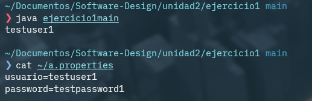

# Ejercicio1

## Explicacion

En este ejercicio se crea una clase configuracion la cual carga un archivo de configuracion (en este caso a.properties) y lee el valor de la llave "usuario"

## Imagen

