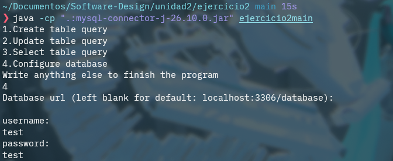
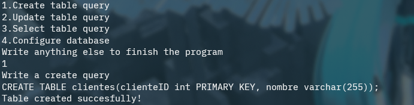
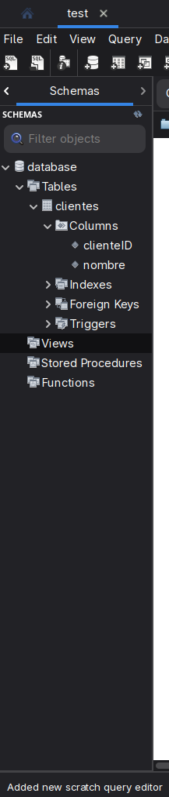
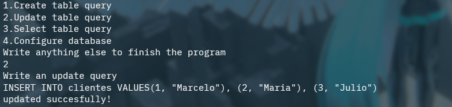
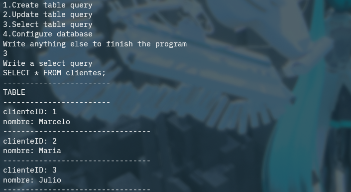

# Ejercicio 2

## Explicacion

En este ejercicio se realiza una conexion a una base de datos MySQL y para eso necesitaremos compilar y ejecutar nuestro programa utilizando [JDBC](https://dev.mysql.com/downloads/connector/j/) y colocaremos el .tar en la misma carpeta que los archivos .java.

Flag de compilacion
```
javac -cp ".:mysql-connector-j-26.10.0.jar" databaseCon.java ejercicio2main.java
```

Flag de ejecucion
```
java -cp ".:mysql-connector-j-26.10.0.jar" ejercicio2main
```
## Imagenes



En esta imagen observamos que al iniciar la aplicacion tenemos un menu donde podemos configurar la base de datos presionando el numero 4.



En esta segunda imagen podemos ver un ejemplo creando una tabla clientes con dos atributos.



Se puede observar en workbench que efectivamente la tabla se creo.



En esta imagen se demuestra como se pueden utilizar update queries como INSERT.



Por ultimo un ejemplo de select para que el programa nos pueda imprimir las distintas tablas de la base de datos.
