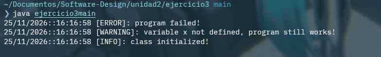

# Ejercicio 3

## Explicacion

Este programa es un logger de eventos basico el cual esta escrito para ser multi-thread safe y se utiliza singleton para que el logger solo pueda ser inicializado una vez. Cada evento tiene una fecha y hora junto a un mensaje indicando su nivel, y por supuesto, un mensaje de evento.

## Imagen

