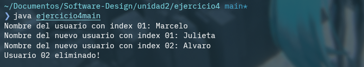

## Ejercicio 4

# Explicacion

Este codigo es un servicio de cache en memoria, el cual es multi-thread safe y solo se inicializa una vez para luego devolver la misma instancia. En el codigo main se demuestran todos los metodos solicitados (almacenar, recuperar, eliminar y consultar), todos los metodos tienen sus validaciones para que el codigo funcione correctamente.

# Imagen

