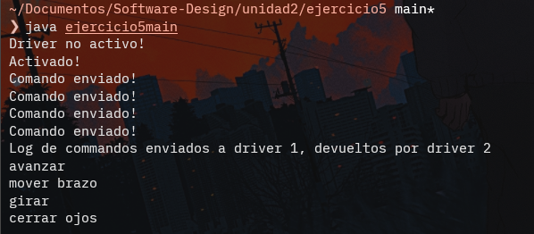

# Ejercicio 5

## Explicacion

Este ejercicio es una simulacion de un driver que permite la conexion y envio de comandos a un robot, Se utiliza el patron Singleton para que no existan dos driver distintos que esten interactuando a la vez con el endpoint.
 
En la imagen se observa que antes de enviar un comando, el codigo verifica que el driver este activo, luego se envian distintos comandos a un objeto driver1 y que a traves del objeto driver2 se recupera un log de estos comandos.

## Imagen

