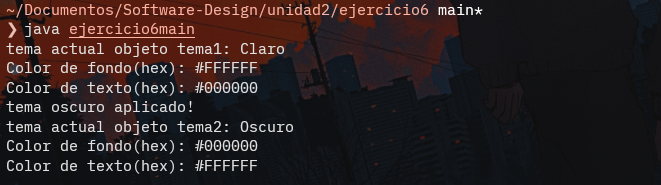

# Ejercicio 6

## Explicacion

En este ejercicio se simula un gestor de temas para una aplicacion, utilizando singleton para que todas las interfaces mantengan coherencia entre si.

En la siguiente imagen se puede observar que los objetos tema1 y tema2 son lo mismo, tambien se muestran los dos getters para el color de fondo y texto.

## Imagen 

